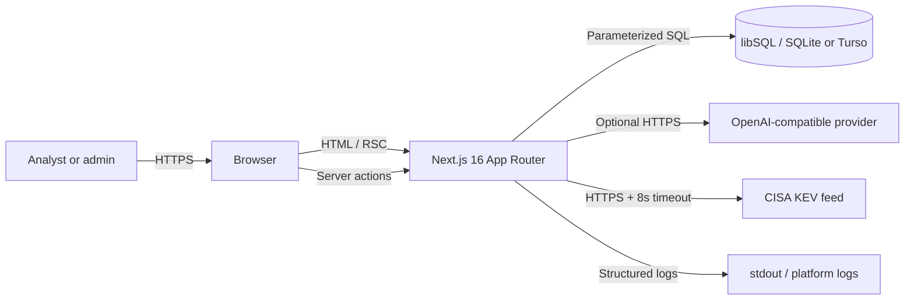
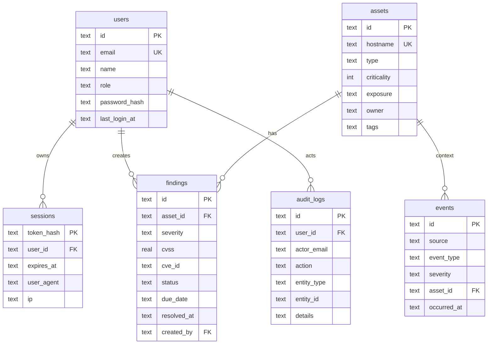
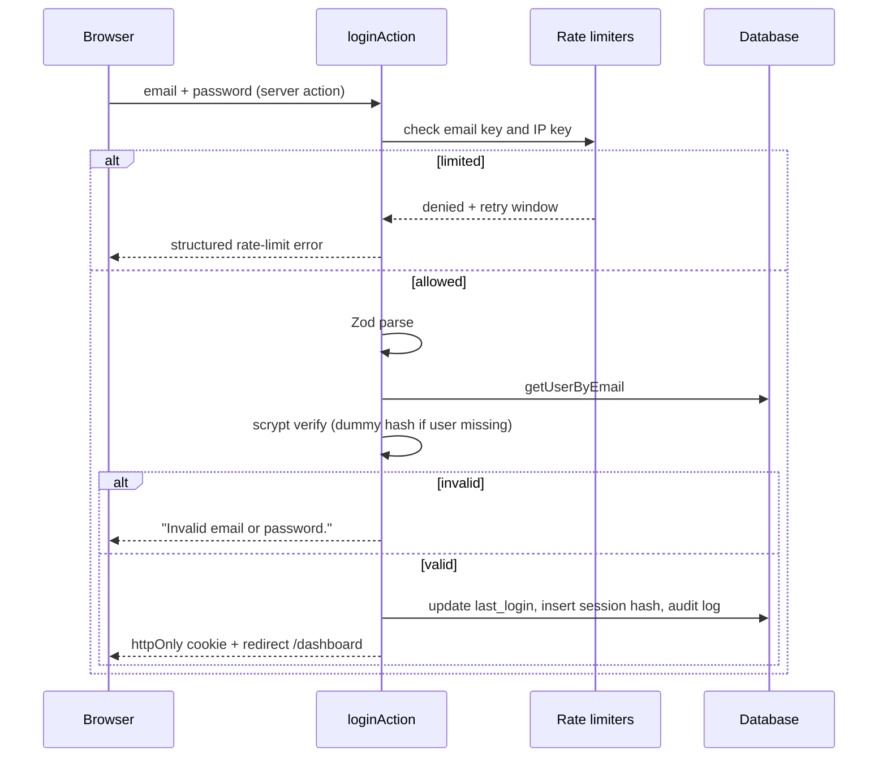
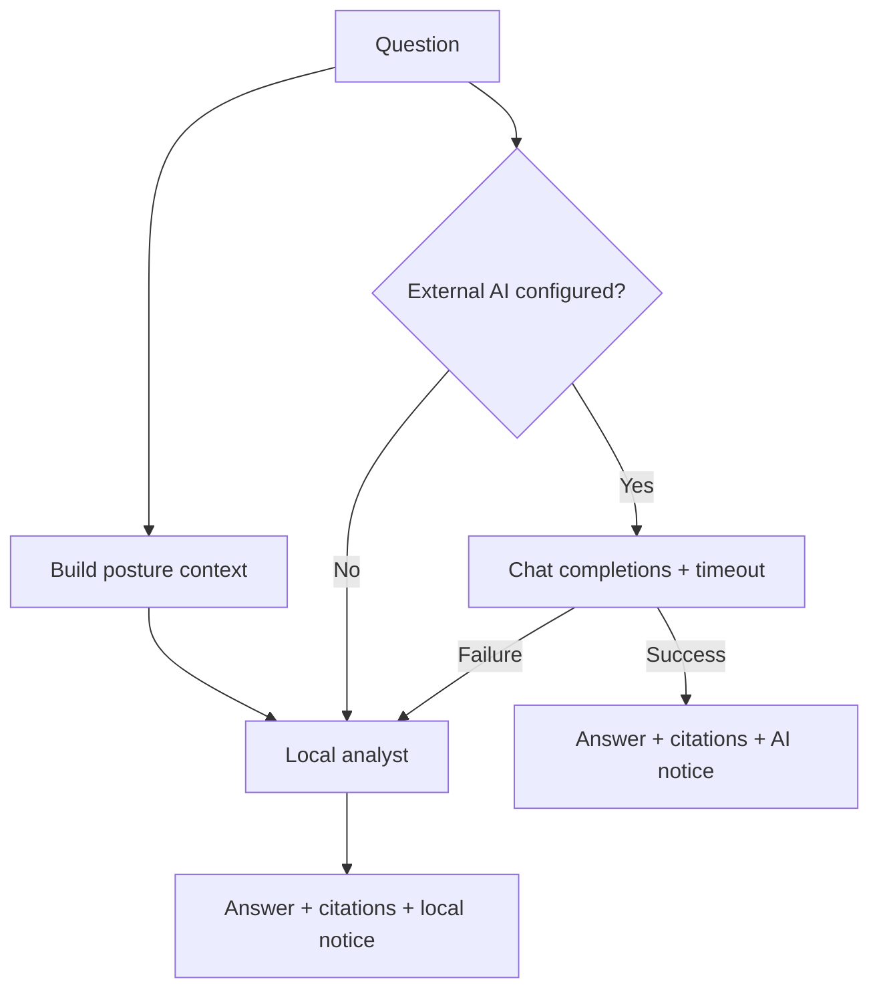

# Architecture

## 1. System context

CyberSentinel is a single Next.js application backed by libSQL. It has no separate API tier, queue, or worker in the MVP. The browser talks to server components and server actions; two route handlers cover health and CSV export.



**Trust boundaries:** browser ↔ Next.js, Next.js ↔ database, Next.js ↔ AI provider, Next.js ↔ CISA. The browser is untrusted. External feeds and model output are untrusted data.

## 2. Runtime model

- **Next.js 16.4 App Router**, React 19 server components by default.
- The authenticated route group `src/app/(app)/` renders a shared shell and forces dynamic rendering, because session cookies and database reads are request-specific.
- Interactive pieces (`LoginForm`, dialogs, filters, copilot, mobile nav, status select, toast) are client components; data fetching and authorization stay on the server.
- Mutations use **server actions** in `src/actions/`, which return a discriminated `ActionState` for form errors or redirect on success.
- **Route handlers** exist only where a non-form response is needed: `/api/health` and `/api/findings/export`.
- `serverExternalPackages: ["@libsql/client"]` keeps the native database client on the Node runtime.

### Rendering and caching

- Protected pages are dynamic; no user data is cached across requests.
- The CISA KEV fetch uses `next.revalidate = 21600` (6 hours). The feed currently exceeds Next's 2 MB data-cache limit, so Next logs a non-fatal warning and fetches it fresh when needed; the UI still receives validated data.
- No stale-while-revalidate or CDN caching is used for authenticated pages.

## 3. Directory responsibilities

```text
src/app/                 Routes, layouts, metadata, error boundaries
src/actions/             Server actions: auth, assets, findings, events, copilot, profile
src/components/          Presentation and client interaction
src/lib/ai/              Context builder, deterministic analyst, provider adapter
src/lib/db/              Client lifecycle, schema, row parsers
src/lib/repositories/    Typed SQL access; no UI imports
src/lib/security/        Password, session, rate-limit primitives
src/lib/services/        Cross-repository analytics
src/lib/validation/      Zod schemas and action-state helpers
src/lib/risk.ts          Pure scoring functions
src/lib/threat-intel.ts  Feed client, validation, fallback
src/types/               Shared domain and action types
scripts/                 Setup, migrate, seed, reset
tests/e2e/               Browser specs and authenticated setup
```

Dependency direction is inward: UI → actions/services → repositories → db. Pure modules (`risk`, `csv`, validation) do not import React or Next.js.

## 4. Data model



### Design notes

- IDs are UUIDs generated in the application layer, not auto-increment integers.
- Timestamps are ISO-8601 strings in UTC. SQLite has no native timestamp type; string comparison is valid in this format.
- Enums are enforced twice: `CHECK` constraints in SQLite and Zod enums in the application.
- `findings.asset_id` uses `ON DELETE RESTRICT`, so deleting an asset with findings fails cleanly rather than orphaning risk. `events.asset_id` uses `SET NULL`.
- `sessions.token_hash` is the primary key; the raw token is never stored.
- `audit_logs.user_id` uses `SET NULL` so history survives user deletion, with `actor_email` retained for attribution.
- Tags are stored as a JSON string in `assets.tags` and parsed at the repository boundary.
- The schema is idempotent and executed at startup. This is an MVP choice; versioned migrations are on the roadmap.

## 5. Request flows

### Sign-in



The same generic error is returned for unknown email and bad password. Verification runs against a dummy hash for unknown users to reduce timing differences. A successful session is a 256-bit random token; only its HMAC-SHA-256 hash is persisted, so a database leak does not directly yield usable cookies.

### Protected page

1. `requireUser()` reads the cookie, hashes it, looks up the session, checks expiry, and loads the user.
2. If absent, redirect to `/login`. `requireAdmin()` additionally redirects non-admins to `/dashboard`.
3. The page calls repositories/services, then renders server components.
4. Client components receive only the fields they need.

`getCurrentUser` is wrapped in React `cache` to deduplicate lookups within one request. It rethrows Next's `DYNAMIC_SERVER_USAGE` signal rather than logging it as a session failure.

### Mutation

```text
Form (client) → server action → requireUser/requireAdmin → Zod parse
             → repository write → audit log → revalidatePath → redirect or ActionState
```

Every write path repeats authorization; hiding a button is never the control. Unique-constraint failures (duplicate email/hostname) are converted into field-level messages. Unexpected errors are logged with an event name and a safe message, then returned as a generic failure.

### CSV export

`GET /api/findings/export` authenticates, applies the same filters as the list page, streams a CSV with a filename and `text/csv` headers, and escapes any cell that could be interpreted as a spreadsheet formula. Export is audited.

### Health check

`GET /api/health` runs a trivial database query and returns status, database mode, version, and timestamp. It returns `503` when the database is unreachable. It exposes no secrets.

## 6. Risk engine

Pure functions in `src/lib/risk.ts`:

```text
findingWeight = severity × status × cvssFactor
orgWeight     = Σ findingWeight × exposure × criticality
securityScore = round(100 × e^(−orgWeight / 280))
assetRisk     = round(100 × (1 − e^(−assetWeight / 18)))
```

- `cvssFactor` is 1 when CVSS is absent, otherwise `0.75 + CVSS/10 × 0.55`.
- Resolved findings contribute zero; accepted risk contributes 0.35 rather than disappearing, so risk acceptance is visible but not equivalent to a fix.
- The timeline reconstructs the score at the end of each of the last 14 days. Current statuses are used, except findings resolved after a given day are treated as active then. This is documented as an approximation.
- MTTR averages resolved findings with valid timestamps and ignores malformed or reversed intervals.

The constants are calibrated for a believable small-team dashboard, not empirically derived. Tests pin expected monotonicity and edge cases.

## 7. AI architecture



- `context.ts` builds a compact, JSON-serializable snapshot: score, counts, top assets, priority findings, recent events, and matched advisories. It does not include password hashes, sessions, emails beyond what the UI shows, or audit logs.
- `local-analyst.ts` classifies intent and composes deterministic answers with citations. This is the default and the fallback.
- `provider.ts` calls an OpenAI-compatible `/chat/completions` endpoint with a 15-second timeout, `temperature: 0.2`, bounded output, and a system prompt that forbids invention and treats all context as data.
- The provider receives only the posture summary or the single finding/asset being remediated, not the whole database.
- Failures never fail the user request: the local answer is returned with a visible notice.
- Copilot server actions are rate limited per user and audited.

**Residual AI risks:** prompt injection through record text, model hallucination, provider data retention, and cost/availability. Mitigations and gaps are in the threat model.

## 8. Threat intelligence

- Fetch CISA KEV with an 8-second abort timeout and 6-hour revalidation.
- Validate the payload defensively: object shape, array length cap, CVE regex, string length truncation, date presence.
- Sort by date added and keep the newest 24 for display.
- Match advisories to registered CVEs case-insensitively.
- On any failure, return a bundled set of real, well-known advisories and label the source as **Bundled**. Never silently present fallback data as live.

## 9. Error handling and logging

- Route-level `error.tsx`, `global-error.tsx`, and `not-found.tsx` provide recovery paths.
- Expected validation failures are returned as typed action state, not thrown.
- Unexpected errors are logged as structured JSON in production (`ts`, `level`, `event`, safe fields).
- User-facing messages are stable and generic; internal messages and stack traces stay server-side.
- The logger contract forbids passwords, tokens, API keys, and raw request bodies.

## 10. Testing architecture

| Layer          | Tool                 | Scope                                                             |
| -------------- | -------------------- | ----------------------------------------------------------------- |
| Pure units     | Vitest               | Risk math, CSV escaping, validation, local analyst                |
| Security units | Vitest               | Password hashing, rate limiter                                    |
| Integration    | Vitest + temp SQLite | Repositories, constraints, filters, analytics data                |
| E2E            | Playwright           | Sign-in, route protection, CRUD flows, admin-only pages, settings |

E2E runs against a **production build** (`next build && next start`), one worker, with a setup project that signs in once and saves storage state. This avoids development compilation delays and catches production-only issues. Tests use accessible roles and labels where possible; a stable ID is used when a label would be ambiguous.

## 11. Performance and operations

- Server components keep the client bundle small; only interactive islands hydrate.
- Dashboard queries run in parallel with `Promise.all`; active findings are capped at 500 and lists are paginated.
- Indexes cover session expiry, finding status/severity/asset/CVE/date, event date/severity, and audit date.
- No background jobs, queues, or websockets. Event simulation is a synchronous server action.
- Health endpoint supports platform probes; logs are structured for aggregation.
- The database is a single file locally, or a remote libSQL database in deployment. There is no built-in backup automation in the MVP.

## 12. Tradeoffs and next steps

| Current choice            | Cost                             | Next step                                                          |
| ------------------------- | -------------------------------- | ------------------------------------------------------------------ |
| Custom auth               | More code to own                 | Add MFA, email verification, password reset, session management UI |
| Idempotent startup schema | No migration history             | Adopt versioned migrations and a backup/restore runbook            |
| In-memory rate limits     | Per-instance only                | Redis/Upstash-backed limiter                                       |
| Reconstructed trend       | Approximate history              | Persist daily score snapshots and status transitions               |
| 500-finding analytics cap | Large orgs truncate              | Aggregate in SQL or paginate analytics                             |
| Single-tenant             | No org isolation                 | Add `org_id` and row-level scoping                                 |
| CSP `unsafe-inline`       | Weaker XSS defense               | Nonce-based CSP with Next middleware                               |
| Local/remote AI fallback  | Nondeterministic external output | Evaluation set, output filtering, provider allowlist               |
